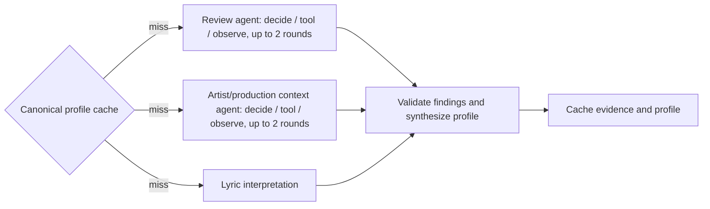

# Song research with LangChain and LangGraph

`GET /recommend/stream?song_name=Bad%20Habit&artist_name=Steve%20Lacy` returns
Pinecone candidates and a research job ID before local inference. Poll
`GET /research/jobs/{id}` for progress and enrichment. The existing `/recommend`
endpoint remains compatible and still performs synchronous lyric explanations.
The UI uses the new endpoint, keeps cards visible on failures, and updates their
details as each suggestion finishes.

## Default: evidence first, no inference queue

`/recommend/stream` defaults to `research_mode=quick`. It runs the review and
context search branches concurrently with no LLM calls, returns matched search
excerpts, and computes transparent content-word overlap across every available
lyric section. The excerpts are retrieval matches, **not semantically verified
findings**. It does not generate a theme explanation or mood profile and does
not claim that word overlap proves meaning or musical similarity. The UI labels
this explicitly and omits the wall of unknown profile ratings.

Use the **Generate AI explanations and vibe profiles (slower)** checkbox (or
`research_mode=deep`) to run the full tool-choosing agent workflow below. Quick
mode is a fixed retrieval workflow, not an LLM agent. Deep mode retains the actual
LangGraph agents for investigation and learning. The tool-choice schema now uses
only `search` or `finish`; Python maps search to each role's scoped tool. This
prevents the small model from selecting the review tool in the context role.

Quick retrieval has a 15-second per-song external research budget and a 60-second
job deadline; these are ceilings, not measured latency promises. Candidate lyric
fetches are also inside the job deadline. Seed and candidate evidence retrieval
overlap in quick mode. Both modes start seed and candidate profiles concurrently; final comparisons
wait for the seed. Deep mode remains slower on CPU.

The observed 389.860-second development job had 28 structured model attempts;
Brave calls took 0.250–0.672 seconds. Late model attempts exceeded 100 seconds
including lock waits. Quick mode removes that inference queue entirely. No new
live timing is claimed until tested against a running backend.

## Graph and agents



In deep mode, the two research nodes are genuine bounded tool-using agents. The local LLM
performs the mandatory first search without an inference call. After extracting
and validating an observation it stops; only missing/unsupported results require
a model decision to search again or finish. Follow-up query indexes stay bounded. It cannot invent
tool names or arbitrary fetch URLs. LangChain `StructuredTool`, prompt/runnable
chains, JSON parsing, and Pydantic models are used inside a LangGraph `StateGraph`.
Parallel branch updates use list reducers. A fan-in edge waits for all three
branches before validation/synthesis. Tests exercise the real compiled graph.

Each deep-mode agent has at most two decision rounds and two search calls. Typed selection
uses fixed song-scoped query alternatives, making the 0.6B model's action space
manageable. JSON gets at most one schema-repair attempt within the same deadline.
Invalid actions are rejected; the system never silently executes
an invented action. This constraint trades open-ended discovery for a reviewable
learning implementation. There is no hosted model fallback.

External I/O is async and can overlap. Local Qwen generation uses the existing
global lock, so inference remains serialized. Job admission is limited to two
active jobs; each includes a seed and up to three candidates. Existing lyric
comparison chains run alongside each candidate's graph, sharing that same lock.

The **review agent** searches published song reviews and criticism for attributed
observations about mood, vocals, instrumentation, energy, and texture. The
**artist/production context agent** searches written artist/producer interviews,
recording breakdowns, and first-hand commentary. They use distinct query options
and scoped tools (`search_reviews` and `search_context`), both backed by Brave.
The video agent and caption tooling have been removed. Existing YouTube values
in a local environment file are ignored and may be removed; do not remove other
existing Spotify/Genius/Pinecone credentials.

## Setup

Install `backend/requirements.txt`, keep the existing downloaded local model, and
configure the optional fields in `backend/.env.example`. From `backend`:

```powershell
.\.venv\Scripts\python.exe -m alembic upgrade head
.\.venv\Scripts\python.exe -m unittest discover -s tests -v
.\.venv\Scripts\python.exe scripts/check_research.py --model --live
```

* `BRAVE_SEARCH_API_KEY`: written search excerpts with actual returned text.
  Use a provider plan/license permitting your intended persistence/caching.
* `LOCAL_LLM_MODEL` / `LOCAL_LLM_DEVICE`: existing local configuration; changing
  the model requires explicit download using the existing script. No larger model
  is automatically downloaded. Qwen3-0.6B often returns insufficient/invalid
  structured reasoning; unknown/unavailable is an expected honest result.
* `RESEARCH_ENABLED`, `RESEARCH_JOB_SECONDS` (120), `RESEARCH_SONG_SECONDS` (60):
  disable or bound deep enrichment. Old larger values are clamped to 120 / 60
  seconds. These include queue waits, not just time generating tokens.

`/research/config` reports capabilities without secrets. Live provider checks
are skipped when keys are missing. Base similarity retrieval still requires the
existing Genius/Pinecone credentials. PostgreSQL schema adds only
`song_research_cache`; cache errors do not remove recommendations.

## Evidence and rubric

Identity is canonicalized from the Genius document fetched by returned song ID,
not solely from potentially stale Pinecone display metadata. Version qualifiers
(remix/live/acoustic/sped up/slowed) are part of the cache key. A preliminary
title/artist/version filter is followed by a separate LLM support/identity check.
The model selects a source/excerpt index and proposes a claim; Python attaches
the actual excerpt and URL. Written evidence has no video timestamp. Invalid indexes are rejected.
Every accepted finding has an existing source ID and an exact excerpt from
the source body. Another check tests whether that excerpt supports the claim.
Excerpt IDs include a content hash so parallel observations from the same URL
cannot overwrite one another. Lyric identity is already verified by canonical
Genius ID; the additional version judgment applies to external observations.
This is more than citation validation, but the small LLM remains fallible;
observations are presented as attributed evidence rather than verified audio truth.

Ratings use **low** (weak/subtle), **medium** (clear/mixed), **high**
(dominant/explicit), **unknown** (insufficient evidence). These are qualitative
prominence judgments, not probabilities or measured statistics. Multiple emotions
may be present. Profile rating explanations undergo another support check.

| Category | Dimensions | Required support |
|---|---|---|
| Lyrical emotions | happy/joyful, confident, sad, longing | lyric excerpts / interpretation |
| Musical characteristics | energy, brightness, tension, acoustic texture | song-specific written reviews, interviews, and production commentary |
| Combined vibe | reflective, triumphant, intimate, bittersweet | both lyrical and musical findings / synthesis |

The lyric profile no longer uses the opening 12 lines. It scans all lyric sections,
deduplicates repeated passages, and selects informative passages from distributed
positions across the song, retaining original line IDs. Short songs fitting the
context budget include all unique passages; longer songs have a 2,800-character
representative context budget. Traces record selected vs total lines and sections.
This is representative coverage, not a claim that the model read every line.
The quick lexical comparison scans every lyric line; the deep pairwise explanation
continues to locate passages across the complete documents.

The text model cannot hear music. This implementation does not analyze audio or
assume Spotify Audio Features access. Musical evidence may be unknown even when
lyrical evidence is available. Both agents currently receive Brave search
excerpts, not full articles. Album reviews support a track claim only when the
actual excerpt explicitly concerns that song. Artist intent is context, not proof
of audible sound. Critic descriptions are attributed opinions. Video URLs are
excluded; this workflow has no YouTube API, caption, or transcript dependency.
It does not fetch complete webpages or bypass paywalls. If excerpts omit the
needed context, the result remains unknown rather than implying a full review
was read.

Comparisons retain seed/candidate finding references and report same/different
validated levels. Unknown dimensions are omitted; absence of evidence does not
mean a song lacks that characteristic. Original lyric prose comparisons are
retained, with an additional support check before the background job publishes
their summary, themes, and difference. Rejected comparisons remain unavailable.
The legacy synchronous endpoint remains unchanged for compatibility.
The UI exposes the canonical researched identity when it differs from
display metadata. Source text is treated as untrusted data in every model prompt.

## Cache, lifecycle, and traces

PostgreSQL stores bounded excerpts, accepted findings, sources, profiles, and
errors under a versioned hash of canonical ID/title/artist/version, model, and
provider availability and quick/deep mode. Full lyric documents are request-scoped; persisted lyric
source text is removed (accepted short evidence quotes remain). Profiles with
findings expire after seven days; quick written-excerpt results after one day; entirely unavailable ones expire after five
minutes. Cached profile reuse skips agent/model research. Accepted deep lyric comparisons are also cached by model, schema, and the full content of both canonical lyric documents, so changed lyrics invalidate the comparison. Jobs remain in memory
for 30 minutes, so restarting the backend invalidates job IDs but preserves caches.
This is a single-worker development implementation; multi-worker deployment needs
a durable queue and shared job store before scaling.

The status endpoint includes structured tool calls, action choices, elapsed and
per-call durations, rejected claims, and failures. The UI's **Research activity**
section shows a readable trace. Local JSONL traces are in
`backend/.research-traces/{job-id}.jsonl` (ignored by Git); they include song queries
and model decision reasons, never API keys/authorization headers. HTTP exception
messages are omitted because URLs can contain credentials. No LangSmith account
or telemetry integration is required.

Timeouts cancel graph waits and stop generation at token boundaries. Lock waits
respect the absolute deadline. A cold model load or in-progress native operation
cannot be forcibly stopped by an asyncio timeout: it may finish in its worker
thread, but canceled jobs do not publish late results. Generation retains the
15-second generation setting for research calls (shorter schema-specific output budgets), while the existing lyric prose chain retains its 45-second setting. Both honor the request deadline. Do not interpret these as
hard process limits or latency promises. Actual durations are recorded.

Offline tests cover parallel I/O, real tool decisions, support vs citation validity,
wrong versions, distinct role queries/tools, album-wide claim rejection, missing providers, cache failures/reuse,
partial branches, deadline expiry, model-lock queue deadlines, and comparisons.
`check_research.py --model` probes actual structured local generation; `--live`
only probes configured providers. UI fixtures are not live research evidence.

Official references: [LangGraph StateGraph](https://reference.langchain.com/python/langgraph/graph/state/StateGraph),
[Brave web search](https://api-dashboard.search.brave.com/api-reference/web/search/get).

## Timeout and empty-profile behavior

The 411.953-second trace exposed 35 structured model attempts and extraction
queue waits above 100 seconds despite sub-second searches. Deep jobs now share
a ten-attempt inference budget (including JSON repair and pairwise generation),
with an absolute 25-second ceiling on each structured request including lock wait.
Research generation retains its 15-second setting and short outputs. A cold model
load/native operation may outlive cancellation; this is not a process kill.

Search nodes publish matched source excerpts to job state before generation.
Publication strips raw source payloads from JSONL trace events, which record only
the source count and timing. Sources remain labeled retrieval matches, not verified
claims. Candidate profile and lyric explanation stages publish independently.
Timeouts retain those sources and the full-song lexical comparison. Empty or
failed analyses report partial/evidence-only results; unknown-only rating grids
and empty similarity/difference sections are hidden. A compact fallback explains
what failed without asserting that the song has no mood.

Profiles are versioned with `v6-relevant-excerpts` so older empty profiles are
not reused. `/research/config` exposes the revision and limits to identify an old
running backend. The current small model is still fallible; a shorter budget
does not establish that it can produce an accurate interpretation. No stronger
model is downloaded automatically and no hosted model is silently substituted.
